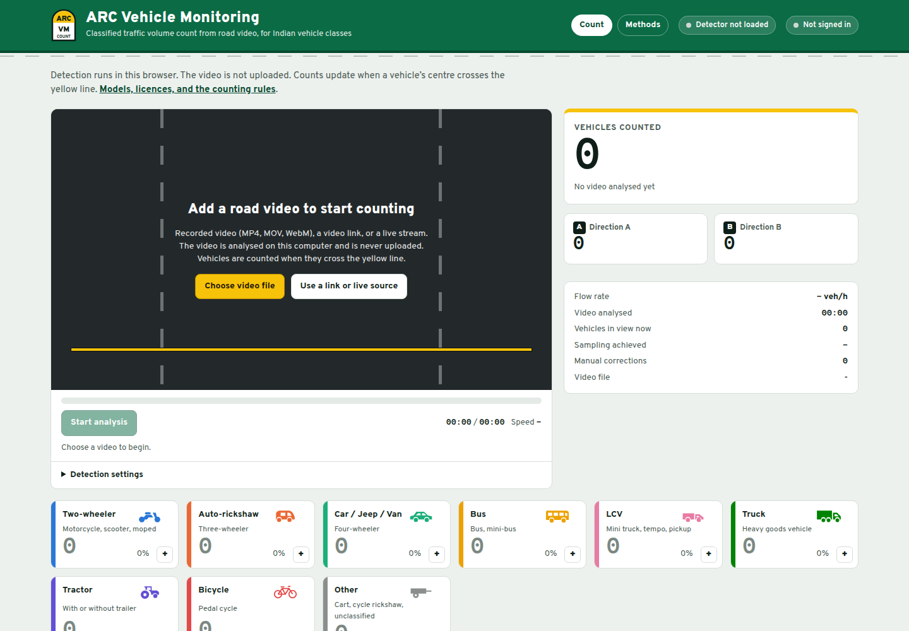
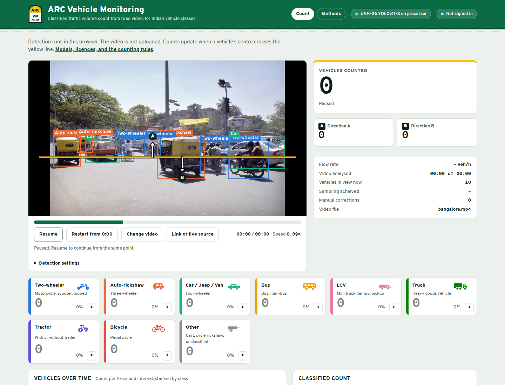
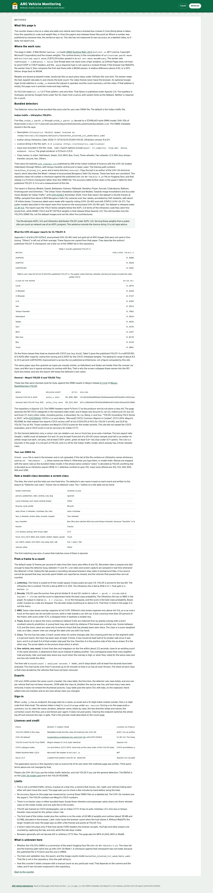

# ARC Vehicle Monitoring

Classified traffic counts from a road video, in the browser. The default detector is an Ultralytics YOLO11s model whose class list is the 14 Indian vehicle classes published with the IISc UVH-26 dataset. Megvii YOLOX-S and YOLOX-Tiny are included for machines that cannot run the larger model. Inference uses ONNX Runtime Web. The video is not uploaded.

Live site, once GitHub Pages is serving this repository: [https://chan424.github.io/arc-vehicle-monitoring/](https://chan424.github.io/arc-vehicle-monitoring/)

The count page asks you to place a line across the carriageway. A vehicle is added when the centre of its tracked box crosses that line. Totals are split by direction and by class, with a time chart, a thumbnail you can correct, and CSV and JSON downloads.

This is a counting aid, not a certified census. The [methods page](methods.html) says which weights are in the repository, which licences apply, and which accuracy numbers belong to the original authors rather than to a test run here.



The counting desk. When `config.js` has a log address, the page asks for sign-in first. Clearing that address shows this view directly, and nothing is logged.



The default detector on a still from a short clip of [Bangalore India traffic](https://commons.wikimedia.org/wiki/File:Bangalore_India_traffic.jpg) by Eirik Refsdal, CC BY 2.0. Boxes are vehicles currently in view (autos, two-wheelers, cars). The total stays at zero until a centre crosses the yellow line. This clip does not move, so nothing is counted. That is the rule, not a missed detection.

## What you can do

- Choose a video file (MP4, MOV, WebM), a direct video link, or a browser tab capture for YouTube and other players.
- Drag the counting line. Direction A and B follow the two sides of the line.
- Read counts for two-wheeler, auto-rickshaw, car, bus, LCV, truck, tractor, bicycle and other. The Indian model’s finer names (hatchback, sedan, SUV, mini-bus, tempo-traveller, and the rest) are kept in the export.
- Add, relabel or remove a count from its thumbnail.
- Download CSV or JSON, or copy the table into a spreadsheet.
- Sign in, when `config.js` has a log address, so each run’s totals can be written by that service. The picture stays on the computer.

## Run it locally

No build step. From the repository root:

```bash
python3 -m http.server 8000
```

Open `http://127.0.0.1:8000/`. The worker, the runtime and the weight files are loaded with relative URLs, so the same tree works at `https://chan424.github.io/arc-vehicle-monitoring/`.

Opening `index.html` as a file will not start the worker. Browsers block module workers from `file://`.

To count without the sign-in gate, set `endpoint` in `config.js` to an empty string. The page then runs in preview mode and posts nothing. With an endpoint set, the page asks for a name, email and Indian mobile number, then a code sent to that email. Only the count summary is posted.

The first run of the Indian detector downloads about 38 MB of weights and 21 MB of runtime, both reassembled in the browser. The worker forces a single WebAssembly thread, so the site does not need cross-origin isolation headers. WebGPU is used when it is present and when its first frame agrees with the CPU session.

## Methods, in short

| Detector | What the file is | Screen classes |
| --- | --- | --- |
| Indian traffic (default) | Ultralytics YOLO11s ONNX, 640 input, 14 names matching the UVH-26 class list. Metadata licence: AGPL-3.0. | Two-wheeler, auto, car types collapsed to car, bus family, LCV, truck, bicycle, other |
| General | Megvii `yolox_s.onnx` from release 0.1.1rc0, byte-identical, 640, Apache-2.0 | COCO bicycle, car, motorcycle, bus, truck. Yellow three-wheelers can be marked as autos. |
| General, fast | Megvii `yolox_tiny.onnx` from the same release, byte-identical, 416, Apache-2.0 | Same COCO subset |

Megvii reports COCO val box mAP 40.5 for YOLOX-S and 32.8 for YOLOX-Tiny. The UVH-26 technical report (arXiv:2511.02563) reports mAP(50:95) 0.3391 for its published YOLO11-S on a 400-image held-out set. Neither number was re-measured in this repository, and the YOLO11s file here has not been checksum-matched to the Hugging Face PyTorch checkpoint. Details, the per-class table, the counting constants, and the limits are on the [methods page](methods.html).



## Layout

```
index.html          count page
methods.html        models, licences, counting rules, limits
css/styles.css      layout
js/app.js           tracking, drawing, exports, sign-in
worker.js           ONNX Runtime session, letterbox, decode, NMS
config.js           optional log endpoint
ort/                ONNX Runtime Web 1.22.0 and the split WASM runtime
uvh26_s.part*.js    YOLO11s weights, base64
yolox_s.part*.js    YOLOX-S weights, base64
yolox_tiny.part*.js YOLOX-Tiny weights, base64
.github/workflows/pages.yml
```

## GitHub Pages

The workflow deploys with GitHub Actions on every push to `main`. After this branch is merged:

1. Repository **Settings → Pages → Build and deployment → Source: GitHub Actions**.
2. The **Publish GitHub Pages** workflow runs.
3. The site is then at `https://chan424.github.io/arc-vehicle-monitoring/`.

The workflow copies the repository into the Pages artifact and adds `.nojekyll`. Weight files stay as they are; the worker still fetches them by relative path.

## Credit

- Indian vehicle classes and the UVH-26 dataset: AIM, Indian Institute of Science. Sharma and others, arXiv:2511.02563. Dataset licence CC BY 4.0. The images are not in this repository.
- YOLO11: Ultralytics, AGPL-3.0, as declared in the ONNX metadata.
- YOLOX: Ge, Liu, Wang, Li and Sun, Megvii, Apache-2.0, arXiv:2107.08430.
- COCO class order: Lin and others, ECCV 2014.
- ONNX Runtime Web: Microsoft, MIT.
